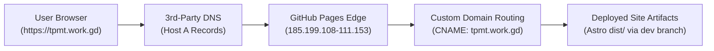

# Complete Guide: Linking a 3rd-Party Domain to GitHub Pages (Dev Branch)

This document provides a comprehensive, step-by-step record of how your 3rd-party domain (**`tpmt.work.gd`**) was linked to your GitHub repository (**`TPMT`**) and configured to automatically build and deploy from the **`dev`** branch.

---

## Architecture Overview



---

## Phase 1: 3rd-Party Domain & DNS Configuration

On your domain provider dashboard (FreeDNS / Registrar), the following DNS records were created:

### 1. Host (A) Records
GitHub Pages requires pointing apex/subdomain traffic to GitHub's four Anycast load-balancer IP addresses:
- `tpmt.work.gd` &rarr; `185.199.108.153`
- `tpmt.work.gd` &rarr; `185.199.109.153`
- `tpmt.work.gd` &rarr; `185.199.110.153`
- `tpmt.work.gd` &rarr; `185.199.111.153`

### 2. Alias (CNAME) Record
To ensure visitors typing `www.tpmt.work.gd` seamlessly redirect to the primary domain:
- `www.tpmt.work.gd` &rarr; `tpmt.work.gd`

### 3. Verification TXT Record
GitHub requires ownership verification to prevent domain hijacking:
- **Host / Name**: `_github-pages-challenge-loki127001mr-crypto.tpmt.work.gd`
- **Value**: `63619f431830dac627092e9201c3f3`

---

## Phase 2: Project Codebase Configuration (On `dev` Branch)

Static site generators like Astro require specific files to integrate cleanly with GitHub Pages:

### 1. The `public/CNAME` File
- **Path**: `public/CNAME`
- **Content**:
  ```text
  tpmt.work.gd
  ```
- **Why it is necessary**: Astro automatically copies everything in `public/` into the build output folder (`dist/`). When GitHub Pages deploys, it reads the `CNAME` file in the root to associate the repository with your domain.

### 2. The `public/.nojekyll` File
- **Path**: `public/.nojekyll`
- **Why it is necessary**: By default, GitHub Pages assumes websites use Jekyll. Jekyll automatically ignores any directory that begins with an underscore (`_`). Because Astro places all bundled CSS, JS, and font chunks inside `_astro/`, Jekyll would block them from loading, causing broken styling. `.nojekyll` disables Jekyll so all assets load perfectly.

### 3. Setting the Canonical Site URL
- **Path**: `astro.config.mjs`
- **Configuration**:
  ```javascript
  export default defineConfig({
    site: 'https://tpmt.work.gd',
    // ...
  });
  ```
- **Why it is necessary**: Ensures metadata, OpenGraph tags, sitemaps, and canonical links reference `https://tpmt.work.gd`.

### 4. Automated CI/CD Workflow for the `dev` Branch
- **Path**: `.github/workflows/deploy.yml`
- **Configuration**:
  ```yaml
  name: Deploy dev branch to GitHub Pages

  on:
    push:
      branches: [ dev ]
    workflow_dispatch:

  permissions:
    contents: read
    pages: write
    id-token: write

  concurrency:
    group: "pages"
    cancel-in-progress: false

  jobs:
    build:
      name: Build Astro Website
      runs-on: ubuntu-latest
      steps:
        - name: Checkout dev branch
          uses: actions/checkout@v4

        - name: Setup Node.js
          uses: actions/setup-node@v4
          with:
            node-version: 22
            cache: npm

        - name: Install dependencies
          run: npm ci

        - name: Build site with Astro
          run: npm run build

        - name: Upload Pages artifact
          uses: actions/upload-pages-artifact@v3
          with:
            path: ./dist

    deploy:
      name: Deploy to GitHub Pages
      needs: build
      runs-on: ubuntu-latest
      environment:
        name: github-pages
        url: ${{ steps.deployment.outputs.page_url }}
      steps:
        - name: Deploy to GitHub Pages
          id: deployment
          uses: actions/deploy-pages@v4
  ```

---

## Phase 3: GitHub Repository & Pages Setup

The following configurations were applied to GitHub to enable the deployment:

### 1. Repository Visibility: Public
- On GitHub Free plans, GitHub Pages is not supported on private repositories (it returns `422: Your current plan does not support GitHub Pages for this repository`).
- The repository was set to **Public** (`PATCH /repos/loki127001mr-crypto/TPMT` with `{"private": false}`).

### 2. Enabling GitHub Pages with GitHub Actions
- Enabled Pages using the workflow engine (`POST /repos/loki127001mr-crypto/TPMT/pages` with `{"build_type": "workflow"}`).

### 3. Registering the Custom Domain
- Saved `tpmt.work.gd` as the custom domain (`PUT /repos/loki127001mr-crypto/TPMT/pages` with `{"cname": "tpmt.work.gd"}`).
- GitHub verified the DNS TXT challenge and approved the domain.

### 4. Critical Fix: Environment Deployment Policy for `dev`
- **Default Behavior**: GitHub Pages environments only permit deployments initiated from the `main` branch.
- **The Solution**: We added a custom deployment branch policy rule to the `github-pages` environment (`POST /repos/.../environments/github-pages/deployment-branch-policies` with `{"name": "dev"}`).
- This allowed GitHub Actions to deploy directly from the **`dev`** branch without requiring merges into `main`.

### 5. Enforcing HTTPS (SSL)
- Once GitHub verified the DNS records, it automatically generated a free TLS/SSL certificate (DigiCert / Let's Encrypt).
- Enabled `https_enforced: true` to guarantee all visitors are redirected to secure `https://`.

---

## Phase 4: Verification & Live Health Checks

The live deployment was verified using direct requests:

| Test | Method / Command | Result |
| :--- | :--- | :--- |
| **DNS Resolution** | `Resolve-DnsName tpmt.work.gd -Server 8.8.8.8` | Returned `185.199.108-111.153` |
| **Homepage** | `https://tpmt.work.gd/` | **200 OK** |
| **Capabilities Page** | `https://tpmt.work.gd/capabilities` | **200 OK** |
| **Contact Form** | `https://tpmt.work.gd/contact-us` | **200 OK** |
| **High-Res Images** | `https://tpmt.work.gd/images/vertical-insert-overmolding-hd.jpg` | **200 OK** |

---

## Phase 5: How It Works Going Forward

Whenever you make future code updates:
1. Make your edits on the **`dev`** branch.
2. Commit and push:
   ```bash
   git add .
   git commit -m "feat: your new feature"
   git push origin dev
   ```
3. GitHub Actions will automatically trigger, build the Astro project, and publish the latest version to **`https://tpmt.work.gd`** in approximately 60 seconds.
